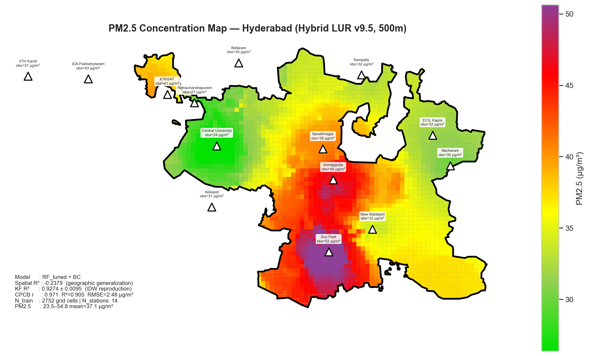

# Hybrid Geospatial PM2.5 Mapping and Interactive Prediction

A geospatial analysis and machine learning project for mapping PM2.5 across Hyderabad, Telangana. It combines CPCB monitoring station observations with road networks, land use, terrain, and satellite measurements, then presents the results through an interactive Streamlit dashboard.

The repository includes the analysis scripts, input datasets, a trained model, and saved maps and evaluation results.

## What the project does

- Cleans daily CPCB observations from 14 monitoring stations.
- Processes Landsat land surface temperature and MODIS aerosol optical depth.
- Runs 20 spatial analysis tasks covering buffers, overlays, road density, terrain, and satellite indicators.
- Compares regression and ensemble models using spatial block and five-fold cross-validation.
- Produces PM2.5 estimates for 2,752 grid cells at 500 m resolution.
- Displays maps, model comparisons, feature importance, and location-based prediction in a dashboard.



## Repository layout

| Path | Contents |
| --- | --- |
| `s.py` | Parser for the raw 2025 CPCB station CSV files |
| `CPCB_Actual_PM25.csv` | Consolidated station observations |
| `LANDSAT/` | Landsat inputs, temperature processing script, and processed raster |
| `MODIS/` | MODIS HDF inputs, AOD processing script, and composite raster |
| `Raster_Data/` | Terrain, Sentinel-2 imagery, and Sentinel-5P gas products |
| `Vector_Data/` | Hyderabad boundary, roads, land use, transport, and station layers |
| `lur_spatial_analysis.py` | Spatial analysis and feature extraction pipeline |
| `model.py` | Model training, evaluation, prediction, and report generation |
| `dashboard.py` | Streamlit application |
| `Output/` | Spatial analysis figures, feature table, and model results |

## Setup

The existing scripts are set up for Windows. Some paths use `Landsat` while the directory is named `LANDSAT`; use consistent casing before running on a case-sensitive filesystem.

Large rasters and the serialized model are stored with **Git LFS**. Install Git LFS before cloning to download the actual files instead of pointer files:

```powershell
git lfs install
git clone https://github.com/abhinavg08/Hybrid-Geospatial-PM2.5-Mapping-and-interactive-prediction.git
cd Hybrid-Geospatial-PM2.5-Mapping-and-interactive-prediction
git lfs pull
```

Create a Python 3.10 Conda environment named `geotaa`. Install the geospatial packages from Conda Forge, then install the remaining Python requirements:

```powershell
conda create -n geotaa -c conda-forge python=3.10 rasterio rasterstats pyhdf
conda activate geotaa
python -m pip install -r requirements.txt
```

Keep the terminal in the cloned repository folder when running the commands below. All project paths are relative to that folder.

The included model was serialized with scikit-learn **1.6.1**, which is pinned in `requirements.txt`. XGBoost and LightGBM extend the training comparison when installed; the training script checks for their availability.

## Run the dashboard

Run from the repository root:

```powershell
python -m streamlit run dashboard.py
```

The dashboard uses the bundled model, prediction CSV, raster and vector layers, and saved figures. These outputs are already included, so retraining is not required to open it.

## Rebuild the analysis

The following commands regenerate outputs and can overwrite the bundled results. Run them from the repository root, except for the satellite processing scripts, which discover files in their own working directories.

```powershell
# Consolidate station measurements.
python s.py

# Rebuild the satellite products if needed.
Push-Location LANDSAT
python process_landsat_lst.py
Pop-Location

Push-Location MODIS
python process_modis_pyhdf.py
Pop-Location

# Run spatial analysis, then train and evaluate the models.
python lur_spatial_analysis.py
python model.py
```

## Method and saved results

The hybrid land use regression pipeline learns an inverse-distance-weighted (IDW) surface derived from station measurements. Environmental predictors describe roads, land use, terrain, and satellite conditions. The comparison also includes models with IDW-lag features, identified separately in the output table.

The saved report selects `RF_tuned` among the models without IDW-lag features. Its five-fold R² is approximately **0.927**, while its spatial block R² is approximately **-0.238**. Those scores measure different validation settings; the spatial result indicates limited generalization to held-out geographic blocks. The station comparison reuses stations that contributed to the IDW target, so it is not an independent validation dataset.

See [`Analysis_Report.txt`](Output/ML_Results_v9.5_Production/Report/Analysis_Report.txt) and [`Model_Comparison.csv`](Output/ML_Results_v9.5_Production/Model_Comparison.csv) for the full saved results. These are estimates from the bundled observations and imagery, rather than a live monitoring feed.

## Data

Inputs include CPCB station exports, Landsat, MODIS, Sentinel-2, Sentinel-5P, and SRTM products, along with the supplied Hyderabad vector layers. Keep all shapefile sidecar files together (`.shp`, `.shx`, `.dbf`, `.prj`, and `.cpg`). Consult the original providers' terms before redistributing or reusing their data.
